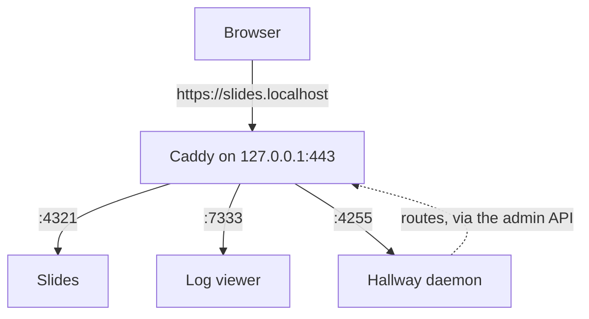

Hallway can link to your apps in two ways. The dashboard works in both and renders the right links for the mode
you're in.

| | **Direct mode** v0, the default | **Fronted mode** v1 |
| --- | --- | --- |
| App URLs | `http://localhost:<port>` | `https://<slug>.<base-domain>` |
| Dashboard | `http://localhost:4255` | `https://hallway.localhost` (or your custom domain's apex), and still `http://localhost:4255` |
| Needs | Nothing | Caddy; a one-time certificate trust; for custom domains, dnsmasq |
| Sudo | Never | Once, during [`hallway setup`](/networking/setup-and-doctor/) |

## Direct mode

No proxy, no DNS, no certificates. Each card links straight to `http://localhost:<port>`. This is the whole of v0,
and it is not a degraded fallback: one page that lists everything running, with its health and a working link, is
the main thing Hallway is for.

## Fronted mode

[Caddy](https://caddyserver.com) sits in front of your apps and serves each one at a memorable HTTPS hostname:

- The default base domain is **`localhost`**: apps live at `<slug>.localhost`. macOS and the major browsers resolve
  any `*.localhost` name to your own machine with no configuration at all, and the name is reserved forever, so
  there is no DNS server to run.
- **HTTPS is required.** Caddy issues certificates from its own local certificate authority, which `hallway setup`
  trusts once.
- **Adding an app never needs sudo.** The unprivileged daemon pushes routes to Caddy's admin API whenever an app file
  changes.
- Hallway's daemon **never proxies app traffic itself**; Caddy does, including WebSockets for hot reload.
- Cards show the hostname first and the port as secondary detail.

Want your own namespace instead, like `https://slides.myname.internal`? See [Custom domains](/networking/custom-domains/).
The details of Caddy, certificates and Host-header rewriting are in [Fronted mode and HTTPS](/networking/fronted-mode/).

## Why HTTPS, even locally?

`http://localhost:<port>` counts as a **secure context** in browsers. `http://app.myname.internal` does not. Without
TLS, moving an app behind a hostname would silently break `crypto.subtle`, service workers, `getUserMedia`, the async
clipboard API and everything else gated on secure contexts. HTTPS everywhere removes the question.
